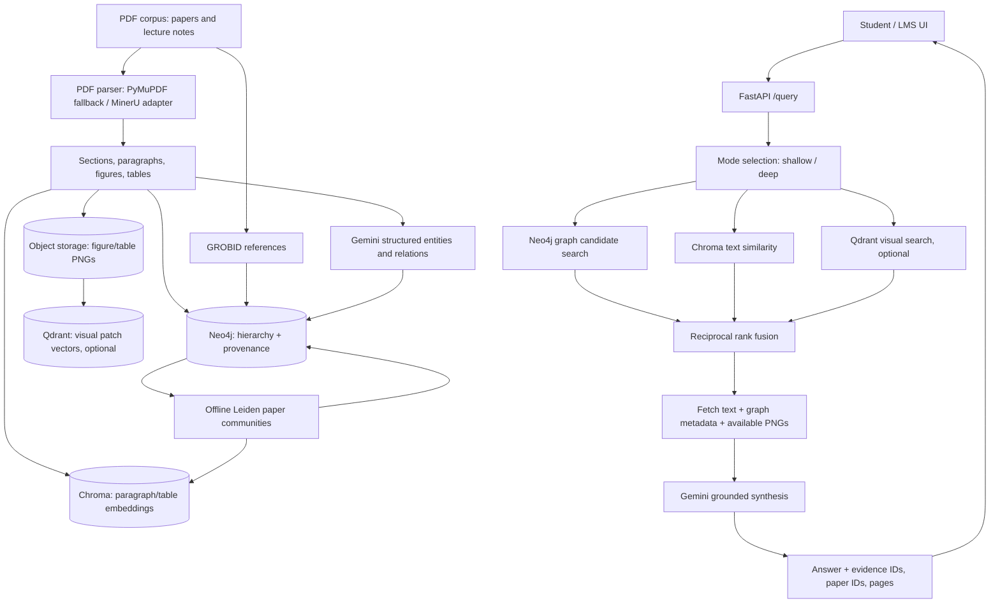
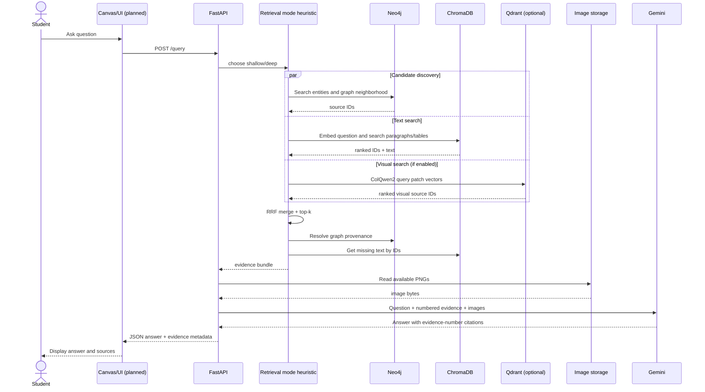

# Research GraphRAG — Architecture, Learning Guide, and Deployment Reference

> **Implementation status:** This repository is a **reference baseline**, not a validated university production deployment. The architecture below explains both the **intended complete system** and the **features actually implemented**. Sections explicitly distinguish these to avoid implying that a planned integration already works. No ASU private infrastructure details or access are assumed.

## 1. What problem are we solving?

A student may ask: **“How did attention-based methods improve over earlier sequence models, and which datasets support those claims?”** A normal keyword search returns papers; a normal text-only RAG system retrieves a few chunks. A research assistant must also understand **which paper said what, how papers cite each other, where the claims occur, and what figures and tables show**. This project combines a structured research graph with text and visual retrieval, then asks a multimodal model to synthesize a sourced answer.

**Core principle:** Neo4j is the **relationship and provenance index**, not a replacement for every storage system. ChromaDB stores searchable text embeddings and retrievable text; Qdrant stores optional visual patch embeddings; filesystem/shared object storage holds PNGs; Neo4j records stable IDs and links. The same source element can be represented in multiple stores without losing its identity.

### Why graph + vectors + images?

| Requirement | Technology | Why this choice? | How it is used |
|---|---|---|---|
| Paper structure and cross-paper links | Neo4j | Explicit, traversable relationships and provenance | `Paper`→`Section`→`Paragraph`/`Figure`/`Table`, `CITES`, `MENTIONS`, entity relationships |
| Semantic meaning in prose | ChromaDB + sentence-transformers | Finds related ideas even when words differ | Embed query; retrieve paragraph and table candidates; fetch stored text by IDs |
| Visual similarity and diagram evidence | Qdrant + optional ColQwen2 | Multi-vector/patch retrieval captures visual details | Encode figure/table images and query; MaxSim retrieves source IDs |
| Actual figure/table pixels | Filesystem, later S3-compatible object storage | Binary images do not belong in graph properties | Store PNG once, record path/URI in Neo4j |
| PDF extraction | PyMuPDF fallback; optional MinerU adapter | Transform unstructured PDFs into indexable elements | Parse pages, paragraphs, images; rich layout requires MinerU integration |
| Bibliography | GROBID | Specialized reference extraction | Parse reference metadata; resolve known DOI/arXiv identifiers to `CITES` edges |
| Scientific entities and synthesis | Gemini + Pydantic | Extract structured methods/datasets/relations and generate responses | JSON-schema validation during extraction; evidence-limited answer generation |
| Research communities | igraph + Leiden | Detect related citation neighborhoods | Offline citation-network partition; store summaries in graph and Chroma |
| Service API | FastAPI | Typed HTTP endpoints and interactive API docs | `/ingest`, `/query`, `/health/live` |
| Background work | Celery + Redis | Ingestion can be expensive | Worker task exists; API does **not yet** enqueue jobs |
| Deployment | Docker Compose / Kubernetes | Reproducible services and portable workload configuration | Local service stack; Kubernetes **application skeleton**, not a complete cluster |

## 2. Big-picture architecture: top to bottom

### 2.1 One-page ASCII system map (target architecture)

This is the **intended end-to-end design**, not a claim that every box is already fully implemented. Read top-to-bottom: first a paper is processed and indexed; after the horizontal divider, a student asks a question and the system retrieves evidence. The graph and vector branches operate **in parallel**, so a missed entity does not hide a relevant paper.

```text
+-----------------------------------------------------------------------+
| CORPUS: 5,000+ arXiv papers + lecture PDFs                             |
+-----------------------------------+-----------------------------------+
                                    | ingest PDF (dedupe by checksum)
              +---------------------+---------------------+
              v                     v                     v
   +--------------------+ +-------------------+ +------------------------+
   | MinerU / PDF parser| | GROBID            | | Gemini + Pydantic      |
   | sections, text,    | | bibliography, DOI, | | methods, datasets,     |
   | page/bbox, figures,| | arXiv IDs, refs    | | models, metrics,       |
   | tables, captions   | | (original PDF)     | | evidence-backed links  |
   +----------+---------+ +---------+---------+ +------------+-----------+
              |                     |                        ^
              +---------------------+                        |
              |              extracted paragraph text -------+
              v
+-----------------------------------------------------------------------+
| NEO4J: PAPER HIERARCHY + RESEARCH KNOWLEDGE GRAPH + PROVENANCE         |
|                                                                       |
| (:Paper)-[:CONTAINS]->(:Section)-[:CONTAINS]->(:Paragraph)             |
| (:Section)-[:CONTAINS]->(:Figure) / (:Table)                            |
| (:Paper)-[:CITES]->(:Paper)                                            |
| (:Paragraph)-[:MENTIONS]->(:Method)                                    |
| (:Method)-[:IMPROVES {evidence_id}]->(:Method)                          |
|                                                                       |
| Each source node: stable ID, paper ID, page, bbox, source/version      |
| Paragraph: chroma_id  | Table: chroma_id, qdrant_id, asset_uri         |
| Figure: qdrant_id, asset_uri  | unresolved citations remain references |
+----------------+----------------------+-------------------------------+
                 |                      |                    |
                 v                      v                    v
       +-------------------+  +------------------+  +-------------------+
       | ChromaDB          |  | Disk / S3        |  | Qdrant            |
       | paragraph + table |  | PNGs, table CSVs |  | ColQwen2 image    |
       | text embeddings   |  | original assets  |  | patch multivectors|
       | + summaries       |  | by stable URI    |  | MaxSim retrieval  |
       +-------------------+  +------------------+  +-------------------+
                 ^                      ^                    ^
                 |                      |                    |
       +-------------------------------------------------------------+
       | OFFLINE LEIDEN JOB: project citation/semantic paper graph;   |
       | detect communities; store memberships + Gemini summaries     |
       | in Neo4j and summary embeddings in ChromaDB                  |
       +-------------------------------------------------------------+

============================ STUDENT QUERY TIME ===========================

                         +---------------------------+
                         | Canvas LMS / student UI   |
                         +-------------+-------------+
                                       | question + session context
                                       v
                         +---------------------------+
                         | FastAPI + auth + router   |
                         | shallow / deep intent     |
                         +-------------+-------------+
                                       |
                         parallel candidate discovery
               +-----------------------+------------------------+
               v                       v                        v
    +----------------------+ +--------------------+ +-------------------+
    | Neo4j graph search   | | ChromaDB search    | | Qdrant visual     |
    | shallow: entity hops | | paragraph, table,  | | image-query       |
    | deep: communities +  | | community vectors  | | multivector MaxSim|
    | multi-hop expansion  | | semantic similarity| | figure/table IDs  |
    +-----------+----------+ +----------+---------+ +---------+---------+
                |                       |                     |
                +-----------------------+---------------------+
                                        v
                         +-----------------------------+
                         | Deduplicate + RRF + rerank  |
                         | graph distance, evidence,   |
                         | source quality, diversity   |
                         +--------------+--------------+
                                        v
              +-------------------------+-------------------------+
              | Fetch by stable ID: Chroma text, Neo4j metadata,  |
              | S3/Disk PNGs and CSVs; enforce context budget     |
              +-------------------------+-------------------------+
                                        v
                         +-----------------------------+
                         | Gemini multimodal answer    |
                         | text + tables + PNGs +      |
                         | captions + graph context   |
                         +--------------+--------------+
                                        v
                         +-----------------------------+
                         | Verify evidence/citations   |
                         | paper, page, section, asset |
                         +--------------+--------------+
                                        v
                         +-----------------------------+
                         | FastAPI -> Canvas LMS / UI  |
                         | answer + clickable sources  |
                         +-----------------------------+
```

**How to interpret the arrows:** Neo4j owns relationships and pointers; ChromaDB and Qdrant are **search indexes**, not substitutes for the graph; Disk/S3 holds the actual image/CSV bytes. During query processing, Chroma and Qdrant run similarity search to discover candidates. Later, the system uses the resulting IDs for exact lookup. `Qdrant.retrieve(ids)` by itself **does not** perform MaxSim reranking. Likewise, the Leiden job runs during indexing/refresh, not on every query. In the graph, `MENTIONS` points from a paragraph to an entity (not `MENTIONED_IN` in the reverse direction).

**Current-code boundary:** The diagram depicts the proposed complete production pipeline. Some capabilities in the repository are baseline or optional adapters; consult the implementation-status notes and production roadmap below before assuming full MinerU, ColQwen2, Canvas SSO, evidence verification, or Kubernetes infrastructure provisioning is operational.

### 2.2 Mermaid view (same system, easier to render)



**Read the diagram in two phases:** the top is **offline ingestion and indexing** (done once per paper or on update); the bottom is **online query processing** (done for every student question). They share stable source IDs.

## 3. First, understand the graph data model

A research paper becomes a set of addressable source elements. Example:

```text
(:Paper {id:'paper-123', title:'Example Research', sha256:'...'})
   ├─[:CONTAINS]→(:Section {id:'section-1', title:'Experiments'})
   │                  ├─[:CONTAINS]→(:Paragraph {id:'para-7', page:5})
   │                  ├─[:CONTAINS]→(:Figure {id:'fig-2', page:6, path:'...'})
   │                  └─[:CONTAINS]→(:Table {id:'table-3', page:6})
   └─[:CITES]→(:Paper {id:'paper-456'})
(:Paragraph {id:'para-7'})-[:MENTIONS]→(:Entity {kind:'Method', name:'...'})
(:Entity)-[:RELATES {predicate:'OUTPERFORMS', evidence:'...', source_paragraph:'para-7'}]→(:Entity)
```

The diagram is **conceptual**. In this code, extracted scientific concepts use the generic `Entity` label with a `kind` property, rather than distinct Neo4j labels `:Method`, `:Dataset`, etc. `RELATES.predicate` represents relation types, rather than separate `:IMPROVES` edge labels. This is simpler to validate and query, though typed labels/edges can be added later.

**Why stable IDs matter:** if a graph traversal finds `para-7`, the same ID must identify the corresponding Chroma document. If it finds `fig-2`, it can use the graph's image path and the Qdrant payload `source_id=fig-2`. This is how text, image, table and citation evidence remain linked.

**What is not stored directly in Neo4j?** Full image bytes and high-dimensional patch vectors. Graph nodes keep their metadata and pointers. The current implementation also stores some text/captions and relationship evidence in graph properties where useful.

## 4. Offline pipeline: what happens when a PDF is uploaded?

### Step 1 — PDF upload and basic validation

`POST /ingest` accepts a multipart PDF. `app/api.py` checks the `.pdf` filename, file-size limit, and `%PDF-` header, then writes a temporary file. **These are basic checks, not a malware scanner or full document security validation.** The endpoint calls ingestion **synchronously**, so very large uploads can time out. A production version should accept an upload, store it durably, enqueue a task, and return a job ID.

### Step 2 — Parse document layout and source elements

`app/ingest.py` calls `mineru_parse()` in `app/extract.py`:

- **Without `MINERU_URL`**: the implemented PyMuPDF fallback extracts page text blocks and embedded images. It places paragraphs in a single `Document` section. It does not reliably recover true headings, table CSVs, captions or coordinates.
- **With `MINERU_URL`**: an **external adapter** must expose `POST /parse` with multipart `file` and return JSON matching the `Paper` Pydantic model in `app/models.py`. This repository does not bundle that adapter or guarantee compatibility with a particular MinerU release.

A richer production adapter should return page number, reading order, bounding box, heading hierarchy, figure/table caption, image path and table CSV/HTML. Preserve provenance at extraction time: information omitted here cannot reliably be reconstructed later.

### Step 3 — Extract bibliography with GROBID

`grobid_references()` sends the PDF to GROBID `processReferences`, reads TEI XML and extracts title, DOI and arXiv ID when present. `GraphStore.save_paper()` attempts to link recognized references to **already indexed** papers using identifiers. This is a graph citation edge, **not a separate citation embedding index**. References whose target paper is ingested later need a second reconciliation pass (not implemented). A robust future version should also normalize DOI/arXiv formats and use cautious title matching.

### Step 4 — Extract methods, datasets and scientific claims

For each paragraph, `extract_entities()` asks Gemini to return Pydantic-validated JSON:

```json
{
  "entities": [{"name":"Transformer", "kind":"Model"}],
  "relations": []
}
```

Allowed kinds are `Method`, `Dataset`, `Model`, `Metric`, `Task`, `Concept`. Allowed predicates are `IMPROVES`, `USES`, `EVALUATES_ON`, `OUTPERFORMS`, `RELATED_TO`. The graph stores mentions and evidence-bearing relations. **Schema validation guarantees shape, not truth**: scientific relation verification and entity alias resolution are future enhancements. Without `GEMINI_API_KEY`, extraction returns an empty result rather than invented entities.

### Step 5 — Write graph and embedding stores

`GraphStore.save_paper()` saves the paper structure, source metadata and available citation edges. `TextStore.upsert()` embeds paragraph text into Chroma collection `paragraphs` and table CSV text (when available) into `tables`. The embedding model is configurable through `EMBEDDING_MODEL` (default `sentence-transformers/all-MiniLM-L6-v2`). `communities` and `entities` collections are initialized, but entity description embeddings are **not currently populated** by ingestion.

When `ENABLE_VISUAL=true`, `app/visual.py` attempts to encode each extracted image with ColQwen2 and writes patch vectors to Qdrant collection `visuals`. Qdrant uses MaxSim on multivectors and retains `source_id`, paper/page/path in the payload. This path is **optional, GPU-intensive, and not validated end-to-end**; the model output dimension must match `VISUAL_DIM`. The default deployment has it disabled.

### Step 6 — Build paper communities offline

`python -m app.community` reads the Neo4j `Paper -[:CITES]-> Paper` projection, runs Leiden through igraph/leidenalg, writes `Community` nodes and `IN_COMMUNITY` edges, and embeds summaries into Chroma `communities`. This job is **not automatically triggered** on upload. Current deep retrieval does **not** seed from communities; that is a planned upgrade. Sparse citation graphs can produce weak clusters, so measure their usefulness rather than assuming topic quality.

## 5. Online pipeline: student question to final answer

This is the most important request lifecycle. Assume the corpus is indexed and the student asks:

> “Compare two attention approaches, explain the trade-offs, and cite the experiments.”

### Step 1 — Student sends a question

A future Canvas/LTI frontend or any HTTP client sends:

```http
POST /query
Content-Type: application/json

{"question":"Compare two attention approaches, explain the trade-offs, and cite the experiments.","mode":"auto"}
```

FastAPI validates the payload using `Query` (`app/models.py`) and calls `answer()` (`app/answer.py`). **There is no implemented Canvas integration, student authentication or conversation/session memory yet**; the API is currently stateless.

### Step 2 — Decide shallow or deep retrieval

`choose_mode()` in `app/retrieve.py` accepts explicit `shallow`/`deep`, or applies a simple keyword heuristic for `auto`. Words such as “compare”, “evolution”, “trend” or “why” tend to select deep. **This is not a LangChain agent or learned classifier in the current code.** A production router could consider question complexity, latency budget, intent and course permissions.

**Shallow** means seek directly relevant evidence. **Deep** means expand graph neighborhoods to find related paragraphs. Deep is not automatically more accurate: expansion can introduce unrelated material, so it must be scored and evaluated.

### Step 3 — Run graph and vector candidate discovery

`retrieve()` calls three possible candidate sources:

1. **Neo4j**: `GraphStore.search()` searches extracted entity names lexically, finds mentioning paragraphs, and in deep mode expands to nearby paragraphs through section/document containment paths. This is currently **lexical graph seeding**, not a query-to-entity embedding search, PageRank or edge-weighted traversal.
2. **ChromaDB**: `TextStore.query('paragraphs', question)` and `TextStore.query('tables', question)` embed the question and find semantically similar text/table entries. This is important when the graph's entity extractor missed a concept.
3. **Qdrant (optional)**: ColQwen2 encodes the question; Qdrant MaxSim searches visual patch vectors and returns source IDs. With `ENABLE_VISUAL=false`, this path is skipped.

These sources are complementary: graph retrieval explains **relationships**, text retrieval finds **semantic relevance**, and visual retrieval helps find **image-specific evidence**. Do not rely on graph-only search as the sole entry point; missed entities would become missed answers.

### Step 4 — Merge and rank candidates

`rrf()` combines the ranked lists using **reciprocal rank fusion (RRF)**. For an item at rank `r` in one list, its contribution is `1 / (60 + r)`; contributions across lists are added. RRF avoids comparing incompatible raw similarity scores from Neo4j, Chroma and Qdrant. The highest-scoring unique source IDs survive up to `RETRIEVAL_LIMIT` (default 12).

**Current limitation:** no trained cross-encoder reranker, no PageRank-based score and no citation confidence weighting. RRF is a sensible baseline, not proof of optimal retrieval.

### Step 5 — Resolve source IDs into evidence

The retrieval layer fetches Chroma documents by ID and graph metadata for matching source nodes. Each evidence item includes source ID, paper ID, page, content kind, optional image path and a simple ranking-derived score. A figure with no extracted caption may provide an image but little textual context. The code does not yet attach rich bibliographic metadata or verify that every image and citation resolves successfully.

**Example conceptual evidence bundle:**

```json
[
  {"id":"paperA:p5-2", "paper_id":"paperA", "page":5, "kind":"Paragraph", "text":"..."},
  {"id":"paperB:v7-1", "paper_id":"paperB", "page":7, "kind":"Figure", "path":"/data/objects/.../page7-image1.png"}
]
```

These are illustrative IDs and snippets, not outputs from a real indexed corpus.

### Step 6 — Generate an evidence-grounded answer

`app/answer.py` formats evidence with numbered references `[1]`, `[2]`, etc. and instructs Gemini to answer **only from supplied evidence**, cite factual claims by evidence number, and admit insufficiency. If local image paths exist, it attempts to attach PNG bytes for up to five evidence entries. The model may receive text and images in the same request. **This does not guarantee citation correctness**; there is no post-generation citation verifier yet. With no Gemini API key, the API returns retrieved evidence excerpts instead of a generated synthesis.

### Step 7 — Return the answer to the student

The endpoint returns an `Answer` object with:

```json
{
  "answer":"A synthesis with [1] and [2] citations...",
  "evidence":[{"id":"...","paper_id":"...","text":"...","page":5,"kind":"Paragraph","path":null,"score":0.5}],
  "mode":"deep"
}
```

The frontend should render citation numbers as clickable links to the **paper, page, section and figure** once source-viewer URLs are implemented. Today the API returns evidence metadata; it does **not** include a deployed PDF viewer or authenticated Canvas UI.

### End-to-end sequence diagram



**Sequence note:** the UI/Canvas box represents the intended client; the code presently exposes the API, not a Canvas LTI integration. The `par` block illustrates logically independent candidate sources; the current Python implementation calls them sequentially, not concurrently.

## 6. Walkthrough of the source code

| File | Responsibility | Read it when learning about… |
|---|---|---|
| `app/models.py` | Pydantic request, document, extraction and response schemas | Data contracts and typed validation |
| `app/config.py` | Environment-based configuration | Service endpoints and model settings |
| `app/api.py` | HTTP routes | Student requests and PDF uploads |
| `app/extract.py` | PDF parsing, GROBID, Gemini entity extraction | Turning documents into structured elements |
| `app/ingest.py` | End-to-end indexing orchestration | Writing graph, text and optional visual stores |
| `app/stores.py` | Neo4j, Chroma and Qdrant access | Persistence, source IDs and graph search |
| `app/embedding.py` | Sentence embedding helper | Semantic vector representations |
| `app/visual.py` | Optional ColQwen2 image/query encoding | Patch embeddings and visual retrieval |
| `app/community.py` | Leiden on paper citation graph | Topic/community detection |
| `app/retrieve.py` | Mode selection, candidates and RRF | Hybrid evidence retrieval |
| `app/answer.py` | Prompt construction and Gemini response | Grounded multimodal generation |
| `app/worker.py` | Celery ingestion task | Future asynchronous jobs |
| `tests/` | Unit and integration test baseline | Regression testing |
| `compose.yaml` | Local multi-service environment | Developer deployment |
| `k8s/` | Kubernetes workload examples | Cluster deployment planning |

**Suggested learning order:** `models.py` → `api.py` → `answer.py` → `retrieve.py` → `stores.py` → `ingest.py` → `extract.py` → `visual.py` → `community.py`. This traces the student question first, then follows the ingestion process that prepared the evidence.

## 7. Local installation and first experiment

### Requirements

Docker Engine with Compose; enough memory/disk for Neo4j, Chroma, Qdrant, GROBID and embedding model downloads; a Gemini API key for extraction/answer synthesis. GPU and compatible optional dependencies are required for practical visual embedding. Read `pyproject.toml` for Python dependency groups.

```bash
cp .env.example .env
# Edit .env: set GEMINI_API_KEY and appropriate endpoints/passwords.
docker compose up --build -d
```

**Important credential detail:** if you change `NEO4J_PASSWORD` in `.env`, ensure `NEO4J_AUTH` in `compose.yaml` agrees. Do not commit real secrets. The first startup can be slow while downloading models.

Upload a sample paper:

```bash
curl -F 'file=@example.pdf' http://localhost:8080/ingest
```

Ask a question:

```bash
curl -s -X POST http://localhost:8080/query \
  -H 'Content-Type: application/json' \
  -d '{"question":"What datasets and methods are discussed?","mode":"auto"}'
```

Browse API docs at `http://localhost:8080/docs`. **For meaningful retrieval, ingest documents first.** If no evidence is found, the service explicitly returns an insufficient-evidence message.

### Testing

```bash
python -m pip install -e '.[test]'
pytest -q
# With services running and integration prerequisites configured:
RUN_INTEGRATION=1 pytest tests/test_integration.py -q
```

The repository includes test code, but the complete integration suite and optional GPU path have **not** been verified in this environment. Recommended additional tests: extraction fixtures for tricky tables, duplicate ingestion, citation reconciliation, image-path resolution, retrieval Recall@k, nDCG@k, citation accuracy, latency under load and recovery from database outages.

## 8. Docker, Kubernetes and ASU deployment design

### Local Docker Compose

`compose.yaml` defines a development service stack. The API and worker use separate Dockerfiles (`Dockerfile`, `Dockerfile.worker`). Containers should communicate using service DNS names, not `localhost` across container boundaries. Persist database volumes and the extracted image directory. For local experiments, development defaults are acceptable; **never publish those credentials or unauthenticated endpoints to the internet**.

### Intended Kubernetes topology

```text
ASU-approved cluster (example only; NOT actual ASU infrastructure)
  namespace: research-graphrag
  ingress: research-rag.example.asu.invalid  [placeholder]
     └─ FastAPI Deployment + Service
           ├─ Neo4j (managed service or persistent cluster)
           ├─ Chroma (persistent deployment/service)
           ├─ Qdrant (persistent deployment/service)
           ├─ Redis broker
           ├─ GROBID service
           ├─ Celery worker Deployment
           └─ Shared PVC / S3-compatible image store
  external: Gemini API; optional MinerU service; optional GPU visual worker
```

The `k8s/` folder is an **application manifest skeleton**, not a full Helm chart or working ASU cluster installer. Actual deployment requires institution-approved image registry, Kubernetes context, namespace, storage classes, DNS, TLS certificates, identity integration, firewall/egress rules, quotas and secrets. Placeholder hostnames, registry names and credentials are **not real ASU settings**. Do not assume access to university servers.

A safe generic deployment workflow:

1. Confirm the target cluster, approved registry, namespaces, GPU quotas, storage, networking and data-handling policy with the infrastructure administrator.
2. Build and tag separate API/worker images; push to the **approved** registry.
3. Create namespace, image-pull secrets, runtime secrets and persistent storage; deploy database dependencies or configure managed endpoints.
4. Update image references and environment configuration in `k8s/`; apply manifests with `kubectl apply -f k8s/` **only after reviewing them**.
5. Configure TLS ingress and authentication; validate service connectivity and readiness.
6. Run smoke tests and representative PDF ingestion/query integration tests before exposing to students.
7. Enable monitoring, backup/restore drills, resource limits, autoscaling and rollback procedures.

**Security minimum for real students:** SSO/OIDC or LTI 1.3, per-course authorization, rate limits, upload scanning, file size/page count caps, safe PDF parsing isolation, secrets management, audit logging, prompt-injection-resistant evidence handling, data retention rules and private database networking. Treat uploaded paper text as **untrusted content**, not instructions to the assistant.

## 9. What should be improved before a 5,000+ paper rollout?

| Priority | Enhancement | Why it matters | Current status |
|---|---|---|---|
| P0 | Version-pinned MinerU adapter and structured table/figure extraction | Accurate multimodal evidence | Adapter contract only; PyMuPDF fallback works |
| P0 | Asynchronous idempotent ingestion, job state, retries and backfill | Scale and failure recovery | Celery task exists; upload remains synchronous |
| P0 | Authentication, authorization, secure storage and upload hardening | Student-facing safety | Not implemented |
| P0 | Citation and source-verification tests | Prevent invented/incorrect citations | Evidence prompt only |
| P1 | DOI/arXiv normalization and citation reconciliation | Correct cross-paper graph | Partial existing-ID matching |
| P1 | Entity canonicalization and relation adjudication | Reduce duplicate/false graph facts | Pydantic schema validation only |
| P1 | Community-summary query seeding and graph scoring | Better multi-paper synthesis | Offline communities only |
| P1 | Cross-encoder reranking and retrieval benchmarks | Improve precision after RRF | Not implemented |
| P1 | Verified GPU ColQwen2 version, batch indexing and visual tests | Production visual search | Optional unverified path |
| P1 | Provenance viewer: PDF page/figure/table links | Auditable student answers | Evidence metadata only |
| P2 | Conversation/session memory with course scoping | Follow-up questions | Not implemented |
| P2 | Canvas LTI 1.3 integration and instructor controls | LMS delivery | Not implemented |
| P2 | Monitoring, tracing, backup/restore and cost tracking | Operability | Not implemented |

### Why not use only Neo4j?

A graph excels at **known explicit links** but cannot reliably find semantically similar unseen text without additional indexing. Likewise, vector search alone struggles with explicit citation chains and evidence provenance. The hybrid design gives each store a specific role and uses shared IDs to connect them. An eventual Neo4j vector index could replace some Chroma functionality, but that should be decided through cost, operational complexity and retrieval benchmarks—not assumption.

### Why not always traverse Neo4j first?

If an entity is missing from the graph, graph-first-only candidate discovery can never retrieve its evidence. This baseline discovers graph and vector candidates independently and merges them. A production implementation could perform **parallel** searches and then graph expansion on the merged seeds, with a final learned reranker.

### Why use Leiden only on selected relationships?

`CONTAINS` edges mainly express document formatting; clustering them often groups nodes by paper rather than research topic. Citation and semantic relation projections are more appropriate for topic detection. Even then, community quality should be evaluated against known subject labels or human judgments.

## 10. Glossary

- **RAG (Retrieval-Augmented Generation):** search for evidence first, then generate an answer conditioned on it.
- **GraphRAG:** RAG that uses graph entities/relationships to discover, connect or organize evidence.
- **Embedding:** numerical representation of text/image content used to compare similarity.
- **HNSW:** approximate-nearest-neighbor indexing for efficient vector search.
- **MaxSim:** late-interaction scoring that compares query vectors to the most similar document patch/token vectors.
- **Provenance:** information about where a claim came from (paper, page, element, evidence span).
- **RRF:** rank fusion that combines lists without requiring their raw scores to be comparable.
- **Leiden:** community detection algorithm for finding densely connected groups in a graph.
- **Pydantic:** Python validation and serialization library used here to enforce structured extraction and API schemas.
- **GROBID:** scholarly document/bibliography parser, used here for references.
- **MinerU:** PDF layout/content extraction system; this repo expects an external compatible adapter.
- **LTI 1.3:** standards-based integration mechanism commonly used for learning tools in an LMS.

## 11. One-paragraph mental model

**At indexing time**, a PDF is parsed into source elements; GROBID extracts references; Gemini extracts structured scientific entities; Neo4j links documents and concepts; Chroma indexes paragraph/table semantics; optional Qdrant indexes visual patches; offline Leiden discovers citation communities. **At question time**, FastAPI receives a student question, selects shallow/deep mode, searches Neo4j and Chroma plus optional Qdrant, merges IDs using RRF, fetches their source text/metadata and available images, and asks Gemini to write an answer limited to that evidence. The API returns both answer text and evidence records so a future Canvas frontend can display verifiable citations.

---

**Project intent:** a teachable, extensible multimodal research GraphRAG baseline. **Deployment claim:** local reference code and Kubernetes examples are provided; a complete MinerU/ColQwen2/Canvas/ASU production deployment requires further integration, testing, security review and real infrastructure configuration.
